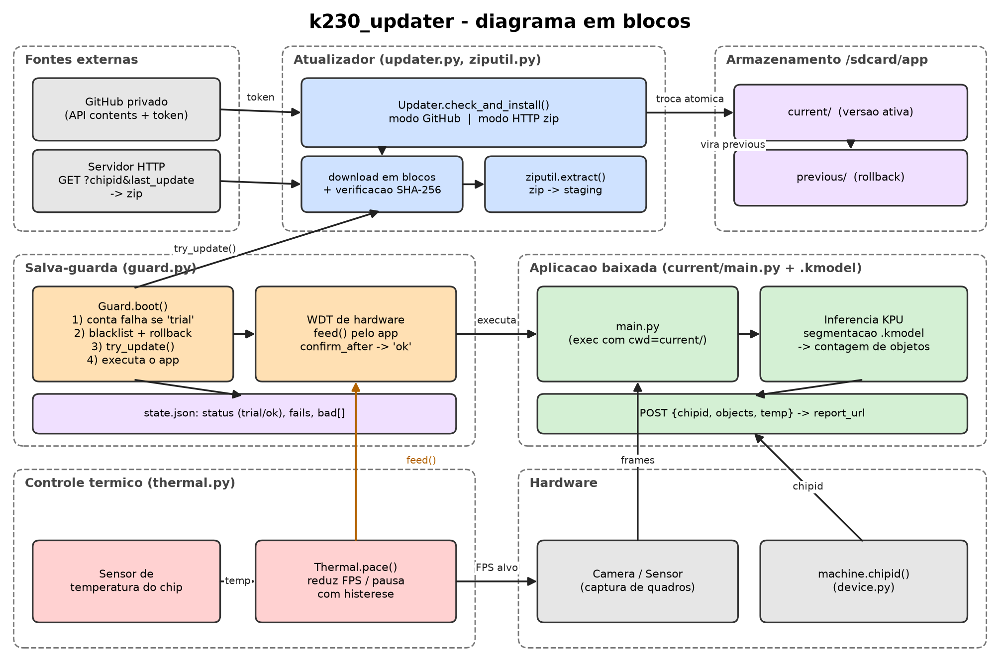

# k230_updater - Documentação técnica

Biblioteca MicroPython para **CanMV K230** com:

1. Atualização remota do programa (`main.py`) e de modelos `.kmodel`, a partir de um repositório GitHub **privado** ou de um servidor HTTP que entrega um **zip**.
2. **Salva-guarda** com watchdog de hardware, rollback automático e atualização corretiva.
3. **Controle térmico** que reduz o FPS de captura para respeitar uma temperatura máxima.

> **Status:** escrita e revisada sem execução em hardware. Apenas o extrator de zip foi testado em um PC. Valide no seu firmware: `machine.WDT`, HTTPS no `requests`, `machine.chipid()` e a leitura de temperatura.

Versão LaTeX desta documentação: [`latex/documentacao.tex`](latex/documentacao.tex).

## Sumário

1. [Arquitetura](#1-arquitetura)
2. [Instalação e configuração](#2-instalação-e-configuração)
3. [Fontes de atualização](#3-fontes-de-atualização)
4. [Salva-guarda com watchdog](#4-salva-guarda-com-watchdog)
5. [Controle térmico](#5-controle-térmico)
6. [Referência da API](#6-referência-da-api)
7. [Exemplo completo: segmentação e relatório](#7-exemplo-completo-segmentação-e-relatório)
8. [Boas práticas](#8-boas-práticas-de-segurança-e-operação)
9. [Solução de problemas](#9-solução-de-problemas)

---

## 1. Arquitetura



| Arquivo | Responsabilidade |
|---|---|
| `main.py` (raiz) | Launcher permanente no cartão SD. Lê `config.json`, cria o `Guard` e chama `boot()`. Não é atualizado remotamente. |
| `k230_updater/guard.py` | Watchdog, estado *trial/ok*, contagem de falhas, versões proibidas, rollback e execução do app. |
| `k230_updater/updater.py` | Busca e instala versões (modo GitHub ou HTTP/zip), verifica SHA-256, troca atômica de diretórios. |
| `k230_updater/ziputil.py` | Extrator de zip para MicroPython (sem `zipfile`). |
| `k230_updater/thermal.py` | Governador térmico: ajusta o FPS conforme a temperatura. |
| `k230_updater/device.py` | `chip_id()`: identificador único do K230 em hexadecimal. |
| `k230_updater/util.py` | `makedirs`, `rmtree`, JSON com gravação segura. |
| `examples/` | App de exemplo, app de segmentação e servidor de referência para PC. |

O diagrama pode ser regenerado com `python docs/latex/make_diagram.py` (requer `matplotlib`).

## 2. Instalação e configuração

### Layout do cartão SD

```
/sdcard/main.py            launcher permanente
/sdcard/config.json        configuração (contém o token: mantenha secreto)
/sdcard/k230_updater/      a biblioteca
/sdcard/app/               criado automaticamente
    current/               versão em execução
    previous/              versão anterior (alvo do rollback)
    staging/               download temporário
    state.json             estado do salva-guarda
```

### `config.json`

| Campo | Padrão | Descrição |
|---|---|---|
| `repo` | - | Repositório privado `dono/repositorio` (modo GitHub) |
| `token` | - | PAT *fine-grained* com **Contents: Read-only** restrito a esse repositório. No modo HTTP, se informado, é enviado como `Authorization: Bearer` |
| `branch` | `main` | Branch consultada (modo GitHub) |
| `update_url` | vazio | Se definido, ativa o modo HTTP/zip |
| `report_url` | - | URL do `POST` do exemplo de segmentação |
| `wdt_timeout` | `10` | Timeout do watchdog (s) |
| `max_fails` | `3` | Falhas antes de proibir a versão e voltar à anterior |
| `confirm_after` | `60` | Segundos alimentando o WDT até a versão ser considerada boa |

Edite `connect()` em `main.py` para o seu meio de rede (Ethernet ou Wi-Fi). **Nunca versione o `config.json`.**

## 3. Fontes de atualização

### 3.1 Modo GitHub (repositório privado)

O repositório contém um `manifest.json` e os arquivos listados:

```json
{
  "version": "1.0.1",
  "entry": "main.py",
  "files": [
    {"path": "main.py", "sha256": "<hex>"},
    {"path": "models/detector.kmodel", "sha256": "<hex>"}
  ]
}
```

- `version`: texto comparado por igualdade; **altere a cada release**.
- `entry`: arquivo executado (padrão `main.py`).
- `sha256`: recomendado; se divergir, a instalação é abortada e `current` fica intacto.

Cada arquivo é obtido por `GET https://api.github.com/repos/<repo>/contents/<path>?ref=<branch>` (`Accept: application/vnd.github.raw+json`) e gravado em blocos de 4 KiB, alimentando o watchdog.

Gerar hash:

```
python -c "import hashlib,sys;print(hashlib.sha256(open(sys.argv[1],'rb').read()).hexdigest())" arquivo
```

### 3.2 Modo HTTP com pacote zip

Com `update_url` definido, a placa executa a cada verificação:

```
GET <update_url>?chipid=<id hex do K230>&last_update=<data da última atualização>
```

- `last_update` é o `updated_at` do manifesto instalado (vazio se nada instalado), codificado como URL.
- **204/304**: nada a fazer. **200**: corpo é um zip com `main.py`, `models/*.kmodel` etc.
- A versão vem do `manifest.json` dentro do zip (opcional) ou do cabeçalho `X-Version`. A data vem do manifesto ou de `X-Updated-At`; na falta de ambos, usa a hora local da placa. Sem versão, a atualização falha.
- Versões proibidas são descartadas depois do download.
- Caminhos absolutos, com `..` ou com `\` no zip são rejeitados.

**Zip e memória:** entradas *stored* (método 0) são copiadas em blocos; para modelos grandes crie o zip **sem compressão** (`zip -0`). Entradas *deflate* (método 8) são lidas inteiras na RAM e exigem `deflate`, `zlib` ou `uzlib` no firmware.

### 3.3 Troca atômica e integridade

O pacote é montado em `staging/`; só depois de tudo baixado e verificado:

1. `previous/` é removido;
2. `current/` é renomeado para `previous/`;
3. `staging/` é renomeado para `current/`.

Falha antes da troca remove `staging/` e não afeta a versão ativa. O `state.json` é gravado em arquivo temporário e renomeado.

## 4. Salva-guarda com watchdog

### Conceito

O watchdog de hardware (`machine.WDT`) é alimentado só pelo app, via `guard.feed()` (ou `Thermal.pace()`). Se o app travar, a placa reinicia. Uma versão nova fica em **teste** (*trial*) até alimentar o watchdog por `confirm_after` segundos; então passa a **ok**.

### Fluxo de boot

1. Inicia o watchdog.
2. Se o estado salvo for *trial*, a execução anterior não foi confirmada: conta uma falha. Ao atingir `max_fails`, a versão atual vai para a lista `bad` e `previous/` é restaurado.
3. Chama `try_update()`: instala qualquer versão nova não proibida. Isso ocorre **antes** de executar o app, então uma correção publicada recupera uma placa em loop de reinicializações.
4. Sem versão executável (nada instalado ou só versões proibidas): aguarda `retry_interval` s alimentando o WDT e tenta de novo.
5. Marca *trial*, grava o estado e executa o `entry` em `current/` (`cwd` e `sys.path` apontam para `current/`).

Depois: exceção não tratada incrementa as falhas e reinicia; retorno normal também reinicia (o app deve rodar indefinidamente); `KeyboardInterrupt` para o watchdog e restaura o estado *ok* para facilitar a depuração.

### Atualização corretiva

Uma versão proibida nunca é reinstalada, mas **qualquer versão com identificador diferente** é. Para corrigir a `1.0.1`, publique a `1.0.2`. O app também pode chamar `guard.update_and_reset()` periodicamente.

### Limitações

- Defeito no launcher ou na biblioteca não tem recuperação remota: mantenha-os mínimos e testados.
- Sem rede, com a versão atual proibida e sem `previous/`, a placa aguarda sem executar o app.
- Carregar um modelo grande pode exceder `wdt_timeout`: aumente-o ou alimente o watchdog antes e depois do carregamento.

## 5. Controle térmico

```python
gov = Thermal(max_temp=75, target_fps=30, min_fps=2, feed=guard.feed)
while True:
    img = sensor.snapshot()
    # ... inferência ...
    gov.pace()    # mantém o FPS, adapta à temperatura e alimenta o WDT
```

A temperatura é lida a cada `interval_ms` (padrão 2000 ms):

| Condição | Ação |
|---|---|
| T ≥ `max_temp + critical_margin` | Nível 2: pausa a captura (alimentando o WDT) até T ≤ `max_temp - hysteresis` |
| T ≥ `max_temp` | FPS × 0,7 (mínimo `min_fps`), nível 1 |
| T ≤ `max_temp - hysteresis` | FPS × 1,15 até `target_fps`, nível 0 |
| caso contrário | mantém o FPS |

Parâmetros: `max_temp`, `target_fps`, `min_fps=1`, `hysteresis=3`, `critical_margin=5`, `interval_ms=2000`, `read=None`, `feed=None`, `on_throttle=None`.

- `read`: função que devolve °C. Se omitida, tenta `machine.temperature` e `machine.TSENSOR`; se nenhuma existir, levanta `RuntimeError`.
- `on_throttle(level)`: chamado quando o nível muda (0 normal, 1 reduzido, 2 pausado). Use para reduzir a frequência da CPU/KPU ou desligar periféricos; a biblioteca não altera frequências por conta própria.

## 6. Referência da API

### `Guard`

```python
Guard(repo, token, root="/sdcard/app", branch="main", wdt_timeout=10,
      wdt_id=1, max_fails=3, confirm_after=60, retry_interval=60,
      connect=None, update_url=None)
```

| Método | Descrição |
|---|---|
| `boot()` | Fluxo completo da seção 4; não retorna normalmente |
| `feed()` | Alimenta o WDT e confirma a versão após `confirm_after` s |
| `confirm()` | Confirma a versão atual manualmente |
| `try_update()` | Verifica/instala atualização; nunca levanta exceção; devolve a versão instalada ou `None` |
| `update_and_reset()` | `try_update()` e reinicia se algo foi instalado |
| `reset()` | `machine.reset()` |
| `start_wdt()` / `stop_wdt()` | Controle do watchdog |

Dentro do app: `import k230_updater; guard = k230_updater.guard`.

### `Updater`

`Updater(repo, token, root, branch, feed, url=None)`: `remote_manifest()`, `local_manifest()`, `install(manifest)`, `check_and_install(skip_versions=())`, `rollback()`. Levanta `UpdateError` em HTTP ≠ 200, manifesto inválido, hash divergente ou pacote sem versão.

### `Thermal`

`pace()`, `update()`; atributos `fps`, `temp`, `level`.

### Utilitários

- `device.chip_id()`: identificador hexadecimal de `machine.chipid()`.
- `ziputil.extract(zip_path, dest, feed=None)`: extrai um zip e devolve a lista de nomes.

## 7. Exemplo completo: segmentação e relatório

`examples/segmentation_app/main.py` é publicado dentro do pacote de atualização, junto com `models/yolov8n_seg.kmodel`. Ele:

1. inicializa a câmera e o `nncase_runtime`, alimentando o watchdog antes e depois de carregar o `.kmodel`;
2. executa inferência de segmentação (estilo YOLOv8-seg), aplica NMS e calcula a área das máscaras;
3. usa `Thermal.pace()` para controlar o FPS;
4. a cada `REPORT_EVERY_S` segundos envia um `POST` JSON para `report_url`:

```json
{"chipid": "...", "objects": 3, "temp": 61.5, "mask_pixels": 1234}
```

`examples/server.py` é um servidor de referência para PC (só biblioteca padrão): `GET /update` entrega o zip da pasta `package/` se for mais novo que `last_update` (ou 204), e `POST /report` imprime os dados recebidos.

> O exemplo é um ponto de partida **não testado**: ajuste tamanho de entrada, classes, normalização, layout das saídas do modelo, chamadas de mídia e leitura de temperatura ao seu modelo e firmware.

## 8. Boas práticas de segurança e operação

- Token somente leitura, restrito a um repositório; rotacione periodicamente.
- Prefira HTTPS; inclua sempre `sha256` no manifesto do modo GitHub. No modo HTTP o zip não é assinado: proteja o servidor e o canal.
- Chame `guard.feed()` (ou `pace()`) em todo laço longo.
- Teste cada release em uma placa antes de publicá-la; considere uma branch `stable` para a frota.

## 9. Solução de problemas

| Sintoma | Causa provável |
|---|---|
| `HTTP 404` | Caminho, branch ou URL incorretos; token sem acesso |
| `HTTP 401/403` | Token inválido, expirado ou sem *Contents: Read* |
| `sha256 mismatch` | Hash do manifesto desatualizado ou arquivo corrompido |
| `zip has no version` | Zip sem `manifest.json` e sem `X-Version`/`X-Updated-At` |
| Reinícios constantes | App não alimenta o WDT; aumente `wdt_timeout` ou chame `feed()` |
| `no temperature sensor found` | API de temperatura diferente no firmware; passe `read=` |
| Placa parada sem app | Versão atual proibida e sem rede ou sem versão nova |
